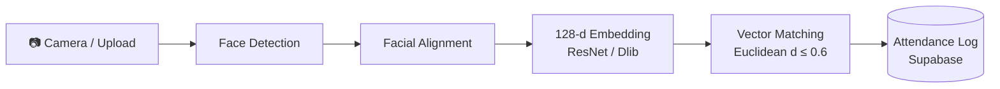

<div align="center">

# 🎓 Smart AI-Powered Attendance System 📸

**Take attendance from a single classroom photo.**
An end-to-end biometric attendance framework built on deep face recognition and vector distance matching, designed to replace manual roll calls and eliminate proxy attendance.


[Features](#-key-features) • [How It Works](#-how-it-works) • [Quick Start](#-getting-started) • [Usage](#-usage-guide) • [Configuration](#-configuration) • [Troubleshooting](#-troubleshooting) • [Roadmap](#-roadmap)

</div>

---

## 📖 Overview

Manual roll calls waste lecture time and are easy to game with proxy attendance. This system lets a teacher upload one or more classroom photos, automatically detects every face, matches each face against the students enrolled in that subject, and writes timestamped attendance records to a cloud database.

New students can be added at any time. Because identity matching uses **embedding distance rather than a trained classifier**, there is **no model retraining** when the roster changes. A student only needs to register once.

---

## 🚀 Key Features

| Feature | Description |
|---|---|
| 📷 **Batch processing** | Scan photos containing many students at once. |
| 🧠 **Deep face embeddings** | 128-dimensional vectors generated with a Dlib / ResNet backbone. |
| ⚡ **Zero-retraining verification** | Match by Euclidean distance (τ ≤ 0.6). Add new students without retraining anything. |
| 👩‍🏫 **Teacher dashboard** | Create subjects, upload classroom snapshots, run AI analysis, and log attendance. |
| 🎒 **Student dashboard** | Self-enroll into subjects using a unique join code. |
| ☁️ **Real-time sync** | Timestamped attendance records are written straight to a Supabase (PostgreSQL) backend. |

---

## 🔬 How It Works



<details>
<summary><b>Pipeline details (click to expand)</b></summary>

1. **Face detection**: every face in the uploaded photo is located and cropped.
2. **Facial alignment**: faces are normalized for pose so that embeddings are comparable.
3. **Embedding generation**: each face is encoded as a 128-dimensional vector.
4. **Vector matching**: the embedding is compared to the stored embeddings of students enrolled in the subject using Euclidean distance. The closest match is accepted only if its distance is **at or below the threshold τ = 0.6**; otherwise the face is treated as *unknown*.
5. **Attendance logging**: matched students are marked present and the record is saved with a timestamp.

**Why matching against the class roster helps:** limiting comparison to the students enrolled in the selected subject (instead of the whole database) reduces the chance of confusing a face with someone from another class.

</details>

---

## 🛠️ Tech Stack

| Layer | Technology |
|---|---|
| Frontend / UI | [Streamlit](https://streamlit.io/) |
| Backend / Database | [Supabase](https://supabase.com/) (PostgreSQL) |
| Computer vision & ML | Python, OpenCV, Dlib, NumPy, Pillow |
| Language | Python 3.x |

---

## ⚙️ Getting Started

### 1. Prerequisites

- Python 3.x
- A free [Supabase](https://supabase.com/) project
- **CMake and a C++ compiler** (required to build Dlib; see [Troubleshooting](#-troubleshooting))

Clone the repository:

```bash
git clone https://github.com/mahboob-alam2027/AI-Attendance-System.git
cd AI-Attendance-System
```

### 2. Set up a virtual environment

```bash
python -m venv venv

# Windows
venv\Scripts\activate

# macOS / Linux
source venv/bin/activate
```

### 3. Install dependencies

```bash
pip install -r requirements.txt
```

### 4. Configure environment variables

Create a `.env` file in the project root:

```env
SUPABASE_URL=your_supabase_project_url
SUPABASE_KEY=your_supabase_anon_key
```

> 🔒 **Never commit your `.env` file.** Make sure it is listed in `.gitignore`.

### 5. Run the app

```bash
streamlit run app.py
```

The app opens at `http://localhost:8501`.

---

## 📘 Usage Guide

### 👩‍🏫 For teachers

1. **Create a subject.** A unique join code is generated for it.
2. **Share the join code** with your students.
3. **Upload a classroom photo** (or several) from the dashboard.
4. **Run AI analysis.** Detected faces are matched to enrolled students.
5. **Review and confirm** the results, then **log attendance** to the database.

### 🎒 For students

1. **Sign up / log in** to the student dashboard.
2. **Enter the subject join code** to enroll.
3. **Register a clear, front-facing photo** of yourself. This is used to generate your face embedding.

### 📸 Tips for best accuracy

- Use a **high-resolution** photo (a modern smartphone camera is enough).
- Keep faces **well lit and unobstructed** (no heavy shadows, masks, or hands over faces).
- Take the photo from a **moderate distance** so each face has enough pixels.
- Use a **sharp, front-facing enrollment photo** for each student.
- If you get misses, try several photos of the class and merge the results.

---

## 🎛️ Configuration

| Setting | Default | Effect |
|---|---|---|
| Distance threshold (τ) | `0.6` | **Lower** = stricter matching (fewer false accepts, more false rejects). **Higher** = looser matching (more false accepts, fewer false rejects). |

Tune the threshold on your own classroom data to balance wrongly accepted faces against missed students.

---

## 📁 Project Structure

```text
├── src/
│   ├── components/      # Reusable Streamlit UI components & dialogs
│   ├── database/        # Supabase setup and query handlers
│   ├── pipelines/       # Face detection and vector matching logic
│   └── ui/              # Base layouts and dashboard styling
├── app.py               # Main entry point for the Streamlit application
├── requirements.txt     # Python dependencies
└── README.md            # Project documentation
```

---

## 🔐 Privacy & Ethics

Face images are biometric data. If you deploy this system:

- **Obtain informed consent** from every student before collecting or processing their images.
- **Store only what you need** (for example, embeddings rather than raw photos where possible).
- **Restrict access** to the database and keep credentials out of version control.
- Follow your institution's policies and local data-protection laws.
- Treat results as **decision support**: let the teacher review matches before they are saved.

---

## 🧯 Troubleshooting

<details>
<summary><b>Dlib fails to install</b></summary>

Dlib compiles from source and needs CMake and a C++ compiler.

- **Windows:** install *Visual Studio Build Tools* (C++ workload) and CMake.
- **macOS:** `brew install cmake`
- **Ubuntu/Debian:** `sudo apt install build-essential cmake`

Then re-run `pip install -r requirements.txt`.

</details>

<details>
<summary><b>Supabase connection errors</b></summary>

- Check that `SUPABASE_URL` and `SUPABASE_KEY` in `.env` are correct and that the file sits in the project root.
- Restart Streamlit after editing `.env`.

</details>

<details>
<summary><b>Faces are not detected or matched</b></summary>

- Use a higher-resolution photo and better lighting.
- Make sure the student's enrollment photo is clear and front-facing.
- Review the distance threshold (see [Configuration](#-configuration)).

</details>

---

## 🗺️ Roadmap

- [ ] Live camera / webcam capture mode
- [ ] Attendance reports and CSV / Excel export
- [ ] Analytics dashboard (attendance trends per subject and student)
- [ ] Liveness detection to prevent photo-of-a-photo spoofing
- [ ] Multiple enrollment images per student
- [ ] Docker support for one-command deployment

---

## 🤝 Contributing

Contributions are welcome!

1. Fork the repository
2. Create a feature branch: `git checkout -b feature/your-feature`
3. Commit your changes: `git commit -m "Add your feature"`
4. Push the branch: `git push origin feature/your-feature`
5. Open a Pull Request


## 👤 Author

**Mahboob Alam**

[](https://github.com/mahboob-alam2027)

---

<div align="center">

⭐ If you find this project useful, please consider giving it a star!

</div>
